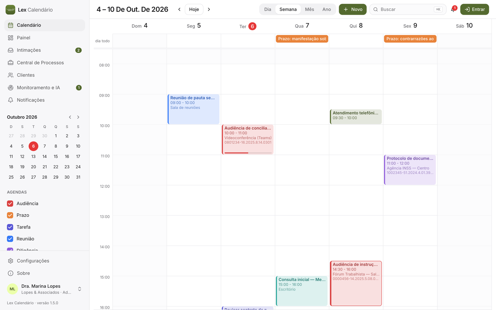
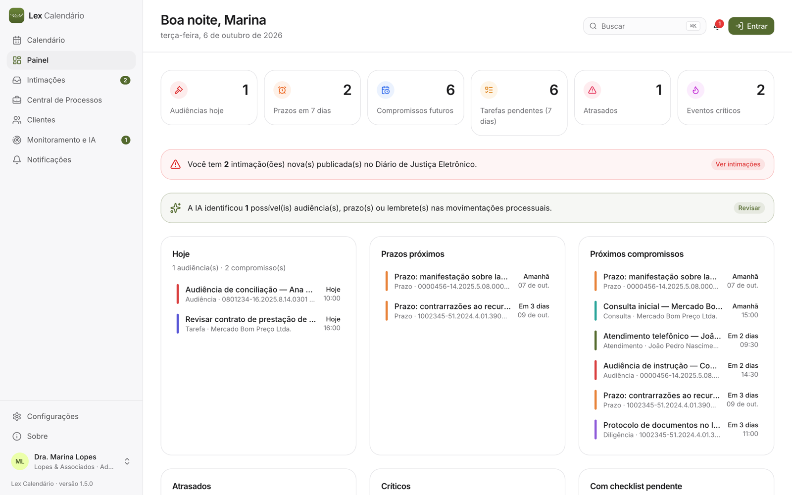
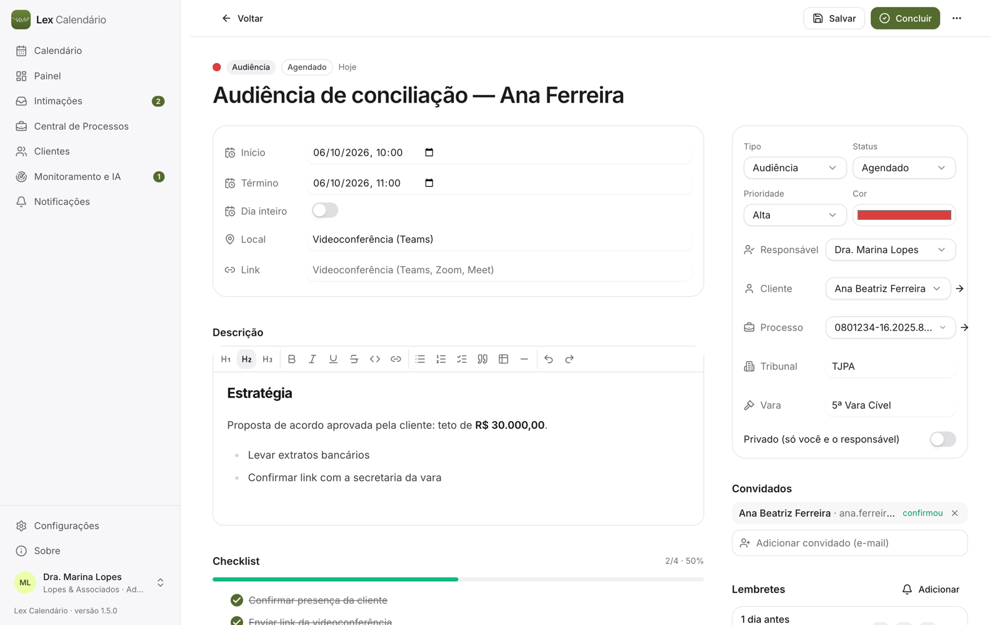
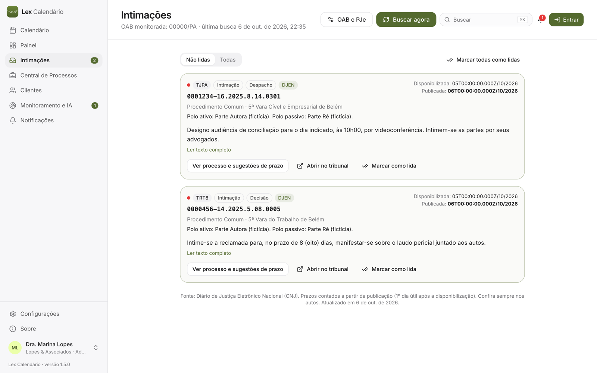
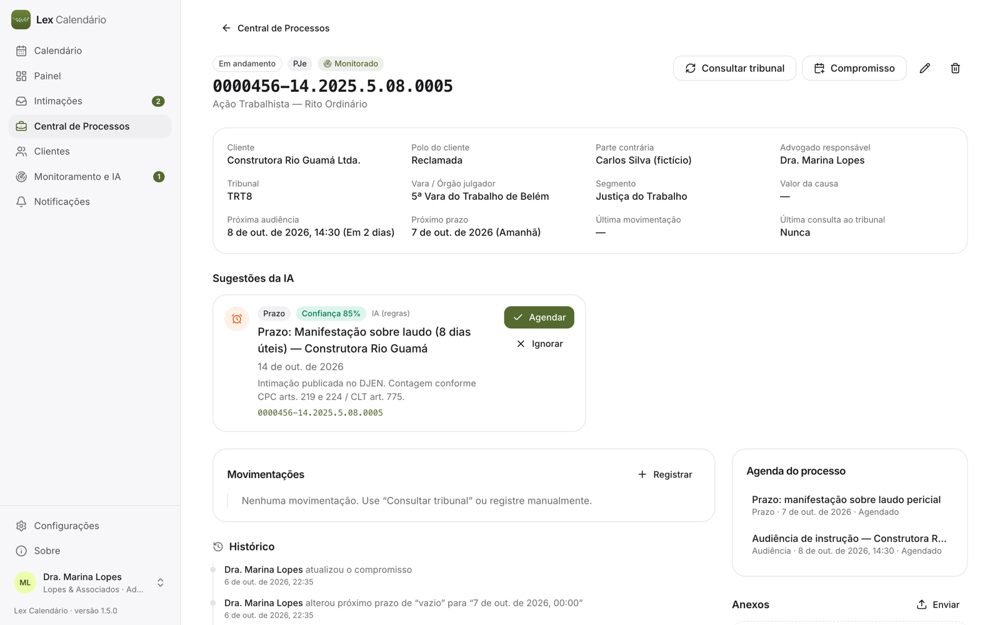
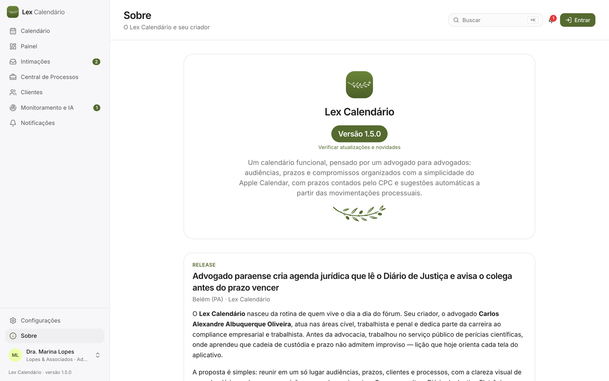

<div align="center">


# Lex Calendário

**Calendário inteligente para advogados e escritórios de advocacia.**
Agenda jurídica no padrão Apple Calendar, prazos calculados pelo CPC, monitoramento processual e sugestões automáticas por IA.


**Repositório privado e proprietário.** Não há distribuição pública: os instaladores ficam nas
[Releases deste repositório](https://github.com/oliveiracarlosadv/Lex-Calendario-codigo/releases) (acesso restrito).

### ⬇️ Instaladores (Releases)

Instaladores com assistente — **Avançar, Avançar, Concluir** (desde a v1.29.0):

| 🍎 macOS (M1–M4) | 🍎 macOS (Intel) | 🪟 Windows 10/11 | 🐧 Linux (Ubuntu, Debian, Mint) |
|:-:|:-:|:-:|:-:|
| `LexCalendario-Instalador-macOS-AppleSilicon.pkg` | `LexCalendario-Instalador-macOS-Intel.pkg` | `LexCalendario-Instalador-Windows.exe` | `LexCalendario-Instalador-Linux.deb` |

Se já houver uma versão instalada, ela é atualizada e os dados são mantidos. Pacotes compactados (alternativa):
`LexCalendario-macOS-AppleSilicon.zip`, `LexCalendario-macOS-Intel.zip`, `LexCalendario-Windows.zip`, `LexCalendario-Linux.tar.gz`.

**Atualizar:** em *Configurações → Aplicativo → Atualizar a partir do arquivo*, escolha o instalador ou o pacote baixado — o Lex faz o
backup antes e mantém os dados. **Desinstalar:** *Configurações → Aplicativo → Desinstalar* ou o arquivo *Desinstalar Lex Calendário* que vem no pacote.

[Política de Privacidade](PRIVACIDADE.md) · [Termos de Uso](TERMOS.md)

</div>

---

## Telas do app

| Calendário (semana) | Painel jurídico |
|:-:|:-:|
|  |  |
| **Compromisso (workspace)** | **Intimações pela OAB (DJEN)** |
|  |  |
| **Processo** | **Sobre** |
|  |  |

<sub>Dados fictícios de demonstração.</sub>

## Índice

1. [Telas do app](#telas-do-app)
1. [Visão geral](#visão-geral)
   - [Aplicativo para computador](#aplicativo-para-computador)
2. [Funcionalidades](#funcionalidades)
3. [Arquitetura](#arquitetura)
4. [Estrutura de pastas](#estrutura-de-pastas)
5. [Requisitos](#requisitos)
6. [Instalação (desenvolvimento)](#instalação-desenvolvimento)
7. [Variáveis de ambiente](#variáveis-de-ambiente)
8. [Banco de dados (Supabase)](#banco-de-dados-supabase)
9. [Autenticação e MFA](#autenticação-e-mfa)
10. [Integrações de calendário](#integrações-de-calendário)
11. [Monitoramento processual e IA jurídica](#monitoramento-processual-e-ia-jurídica)
12. [Notificações](#notificações)
13. [Permissões (papéis)](#permissões-papéis)
14. [Testes e qualidade](#testes-e-qualidade)
15. [Deploy em produção (Vercel)](#deploy-em-produção-vercel)
16. [CI/CD — GitHub Actions](#cicd--github-actions)
17. [Roadmap](#roadmap)
18. [Sobre o autor](#sobre-o-autor)
19. [Privacidade e Termos de Uso](#privacidade-e-termos-de-uso)
20. [Licença](#licença)

---

## Visão geral

O **Lex Calendário** é um SaaS multi-escritório (multi-tenant) para gestão da agenda jurídica. A interface segue a linguagem visual do Apple Calendar — tipografia limpa, cores suaves, modo claro e escuro — com visualizações de **Dia, Semana, Mês e Ano**, além da visão **Equipe** (agenda por responsável, FullCalendar Premium).

Cada compromisso abre uma **página própria**, um mini workspace jurídico com descrição em editor rico (estilo Notion), checklist com percentual de conclusão, lembretes múltiplos, anexos, comentários e histórico completo de alterações.

### Aplicativo para computador

| Sistema | O que o duplo clique faz |
|---|---|
| macOS | Instala *Lex Calendário.app* em **Aplicativos** (Launchpad e Spotlight, como os apps do sistema), fixa o ícone no **Dock** e guarda os dados em **Documentos/Lex Calendário/dados**. Na 1ª vez: botão direito → Abrir (app sem notarização da Apple). |
| Windows | Copia tudo para **Documentos\Lex Calendário** e cria atalhos na **Área de Trabalho**, no **Menu Iniciar** e na **barra de tarefas** (no Windows 11 a fixação pode exigir um clique manual: botão direito no atalho → Fixar na barra de tarefas). |
| Linux | Copia tudo para **Documentos/Lex Calendário** e cria o atalho na **Área de Trabalho** e no menu de aplicativos. |

Como funciona: o app roda um servidor local (Node.js embarcado) em `127.0.0.1:47830` com um **PostgreSQL embutido (PGlite)** que usa as mesmas migrations da versão em nuvem. Dados, anexos e configurações ficam em `Documentos/Lex Calendário/dados`. Lembretes e sincronizações rodam enquanto o app está aberto.

**Sincronização (opcional):**
- **Apple (iCloud):** funciona direto — Entrar → Apple, com o Apple ID e uma senha de app (API CalDAV oficial).
- **Google e Microsoft:** usam OAuth oficial com PKCE. Para habilitar nos instaladores, o mantenedor cadastra uma única vez `GOOGLE_CLIENT_ID` e `MICROSOFT_CLIENT_ID` (variáveis) e `GOOGLE_CLIENT_SECRET` (secret) no repositório — veja [`docs/INTEGRACOES.md`](docs/INTEGRACOES.md#aplicativo-desktop). Os usuários finais não configuram nada.

## Funcionalidades

| Módulo | Destaques |
|---|---|
| **Calendário** | Dia, Semana, Mês, Ano e Equipe · arrastar e soltar · redimensionar · criação rápida por seleção · categorias com cores personalizáveis · mini calendário · filtros |
| **Compromissos** | Audiência, Prazo, Reunião, Diligência, Consulta, Atendimento, Lembrete e Personalizado · cliente, processo, tribunal, vara, responsável, prioridade e status |
| **Workspace do evento** | Editor rico (títulos, listas, checklist, tabelas, links, citações, código) · checklist com progresso · anexos (PDF, DOCX, XLSX, imagens…) · comentários em tempo real · histórico |
| **Lembretes** | 30 min, 1 h, 2 h, 1, 3, 7, 15 e 30 dias antes · vários por evento · push web, e-mail e alerta na plataforma |
| **Painel** | Audiências de hoje, prazos próximos, compromissos futuros, pendentes, atrasados, críticos e indicadores de produtividade |
| **Clientes** | Pessoa física/jurídica · CPF/CNPJ validados · endereço · processos vinculados · histórico de atividades |
| **Processos** | Número CNJ validado (módulo 97) · classe, tribunal, vara, cliente, responsável, status · última movimentação · próxima audiência e próximo prazo (atualizados automaticamente pela agenda) |
| **Central de Processos** | Visão consolidada com filtros, indicadores e sugestões pendentes da IA |
| **Monitoramento** | Conectores TJPA (WebService oficial), PJe (MNI 2.2.2), DataJud/CNJ · arquitetura pronta para e-SAJ, Projudi e eproc · certificado A1 |
| **IA jurídica** | Lê movimentações e sugere audiências, prazos (contagem CPC arts. 219, 220 e 224) e lembretes · analisador por regras + modelo **open source e gratuito** via Ollama (Qwen 2.5, Llama 3.1…) · opcional: endpoints compatíveis ou Claude |
| **Integrações** | Google Calendar (bidirecional, webhooks) · Outlook/Microsoft 365 (Graph, delta + subscriptions) · Apple iCloud (CalDAV) · importação/exportação ICS |
| **Busca global** | ⌘K / Ctrl+K — clientes, processos, eventos e anotações (full-text em português) |
| **Equipe** | Administrador, Sócio, Advogado, Assistente e Secretária · convites por e-mail · RLS no banco |

## Arquitetura

Clean Architecture + DDD, com dependências apontando para o domínio:

```
┌──────────────────────────── app/ (Next.js App Router) ────────────────────────────┐
│  Páginas, layouts, Route Handlers (APIs, webhooks, cron)                          │
└───────────────┬───────────────────────────────────────────────┬───────────────────┘
                │                                               │
     components/ hooks/ stores/                       application/ (casos de uso)
     (UI, TanStack Query, Zustand)                    sincronização, monitoramento,
                │                                     lembretes
                └──────────────────────┬────────────────────────┘
                                       ▼
                         domain/ (regras puras, sem framework)
              eventos · prazos (CPC) · CNJ · CPF/CNPJ · permissões · portas
                                       ▲
                                       │ implementa as portas
                         infrastructure/
       Supabase · Google · Microsoft · CalDAV · ICS · Web Push · E-mail
       IA (regras + Ollama/open source) · Tribunais (TJPA, PJe MNI, DataJud) · Criptografia
```

- **Banco**: PostgreSQL (Supabase) com Row Level Security em todas as tabelas; regras críticas (histórico, reagendamento de lembretes, próxima audiência/prazo do processo) em triggers.
- **Tempo real**: Supabase Realtime para eventos, comentários, checklist e notificações.
- **Segredos**: tokens OAuth, senhas CalDAV e credenciais de tribunais criptografados com AES-256-GCM; colunas sensíveis inacessíveis ao papel `authenticated`.

Detalhes em [`docs/ARQUITETURA.md`](docs/ARQUITETURA.md) e [`docs/INTEGRACOES.md`](docs/INTEGRACOES.md).

## Estrutura de pastas

```
.
├── .github/workflows/        # CI (lint, testes, build), deploy e preview na Vercel
├── docs/                     # Documentação e página do projeto (GitHub Pages)
├── public/                   # Ícones, logotipo (ramo de oliveira), service worker
├── supabase/
│   ├── migrations/           # Esquema, RLS, funções e triggers
│   └── seed.sql              # Dados de demonstração (somente local)
├── src/
│   ├── app/                  # Rotas (App Router) e APIs
│   ├── application/          # Casos de uso
│   ├── components/           # UI (shadcn/ui), calendário, editor, módulos
│   ├── domain/               # Entidades, value objects, regras e portas
│   ├── hooks/                # Hooks de dados (TanStack Query)
│   ├── infrastructure/       # Adaptadores (Supabase, integrações, IA, tribunais)
│   ├── lib/                  # Utilitários
│   └── stores/               # Estado de UI (Zustand)
└── tests/                    # Testes unitários (Vitest)
```

## Requisitos

- **Node.js 20.11+** (recomendado 22 LTS) e npm
- **Supabase CLI** e **Docker** (para o banco local)
- Opcional: [Ollama](https://ollama.com) para a IA open source (`ollama pull qwen2.5:7b`)
- Contas opcionais: Google Cloud, Microsoft Entra ID, Apple Developer, Vercel, Resend

## Instalação (desenvolvimento)

```bash
git clone https://github.com/oliveiracarlosadv/Lex-Calendario-codigo.git
cd Lex-Calendario
npm install
cp .env.example .env.local
npm run db:start      # sobe Supabase local (Docker) e aplica migrations + seed
npm run dev           # http://localhost:3000
```

Após `db:start`, copie `API URL`, `anon key` e `service_role key` exibidos no terminal para o `.env.local`.

**Acesso de demonstração (somente local):** `demo@lexcalendario.local` · senha `LexDemo#2026`.

Gere as chaves restantes:

```bash
openssl rand -base64 32          # ENCRYPTION_KEY
openssl rand -hex 32             # CRON_SECRET
npm run vapid:generate           # NEXT_PUBLIC_VAPID_PUBLIC_KEY / VAPID_PRIVATE_KEY
```

## Variáveis de ambiente

Todas documentadas em [`.env.example`](.env.example). Principais:

| Variável | Uso |
|---|---|
| `NEXT_PUBLIC_SUPABASE_URL` / `NEXT_PUBLIC_SUPABASE_ANON_KEY` | Conexão com o Supabase |
| `SUPABASE_SERVICE_ROLE_KEY` | Cron, webhooks e integrações (somente servidor) |
| `ENCRYPTION_KEY` | AES-256-GCM dos tokens e credenciais |
| `CRON_SECRET` | Protege `/api/cron/*` |
| `GOOGLE_CLIENT_ID` / `GOOGLE_CLIENT_SECRET` | Login Google + Google Calendar |
| `MICROSOFT_CLIENT_ID` / `MICROSOFT_CLIENT_SECRET` | Login Microsoft + Outlook |
| `NEXT_PUBLIC_VAPID_PUBLIC_KEY` / `VAPID_PRIVATE_KEY` | Notificações push |
| `RESEND_API_KEY` / `EMAIL_FROM` | Lembretes por e-mail |
| `AI_PROVIDER` / `AI_MODEL` / `OLLAMA_BASE_URL` | IA jurídica — padrão `ollama` + `qwen2.5:7b` (open source, gratuito) |
| `DATAJUD_API_KEY` | API Pública do DataJud (CNJ) |
| `NEXT_PUBLIC_FULLCALENDAR_LICENSE_KEY` | Licença FullCalendar Premium (visão Equipe) |

## Banco de dados (Supabase)

| Migration | Conteúdo |
|---|---|
| `…0001_core_schema.sql` | Organizações, perfis, membros, convites, categorias, clientes, processos, movimentações, eventos, checklist, lembretes, anexos, comentários, histórico, notificações, conexões de calendário, sugestões da IA, credenciais de tribunais, certificados A1 |
| `…0002_security_rls.sql` | Funções de autorização, RLS por papel, buckets de Storage e permissões por coluna |
| `…0003_functions_triggers.sql` | Onboarding automático, categorias padrão, lembretes, histórico, agregados do processo, busca global, indicadores do painel, aceite de sugestões, Realtime |

```bash
npm run db:reset   # recria o banco local com seed
npm run db:push    # aplica migrations no projeto remoto (após supabase link)
npm run db:types   # gera tipos TypeScript do banco
```

## Autenticação e MFA

- E-mail e senha, **Google**, **Microsoft (Azure AD)** e **Apple ID** via Supabase Auth.
- **MFA opcional (TOTP)** em *Configurações → Segurança*; quando ativo, o middleware exige nível AAL2.
- No painel do Supabase, habilite os provedores e cadastre a URL de retorno `https://SEU_DOMINIO/auth/callback`.

## Integrações de calendário

| Provedor | Como funciona |
|---|---|
| **Google Calendar** | OAuth 2.0 (escopo `calendar`) · envio imediato ao salvar · recebimento por *push notifications* (`events.watch`) + sync incremental (`syncToken`) · renovação diária dos canais |
| **Outlook / Microsoft 365** | Microsoft Graph · `calendarView/delta` · *subscriptions* com renovação automática |
| **Apple Calendar (iCloud)** | CalDAV (`caldav.icloud.com`) com senha de app · sincronização bidirecional por `ctag`/`etag` a cada 10 min |
| **ICS** | Exportação (`/api/ics/export`) e importação de arquivos `.ics` · assinatura por URL |

Configuração passo a passo em [`docs/INTEGRACOES.md`](docs/INTEGRACOES.md).

## Monitoramento processual e IA jurídica

1. **Coleta** (`/api/cron/monitoring`, a cada 3 h): consulta os processos monitorados nos conectores, em ordem:
   - **TJPA — WebService oficial** de Consulta Processual (SOAP, público);
   - **PJe — MNI 2.2.2** (`consultarProcesso`) com as credenciais do advogado, criptografadas;
   - **DataJud — API Pública do CNJ** (cobertura nacional).
2. **Análise**: cada nova movimentação passa pelo analisador por regras (audiência designada, intimações, prazos expressos ou legais presumidos, sentença, trânsito em julgado…) e, para casos ambíguos, por um **modelo de linguagem open source e gratuito** rodando no **Ollama** (padrão `qwen2.5:7b`; também funciona com Llama 3.1/3.3, Mistral e Gemma, ou qualquer servidor compatível como vLLM, LM Studio, Groq e OpenRouter). O Claude é uma alternativa opcional.
3. **Sugestão**: o advogado aceita com um clique; o evento é criado com lembretes padrão e vinculado ao processo.

Prazos usam dias úteis, excluem o dia do começo, prorrogam vencimentos em dias sem expediente e respeitam o recesso de 20/12 a 20/1 (CPC arts. 219, 220 e 224). Feriados locais podem ser cadastrados por escritório. **As sugestões não substituem a conferência do advogado.**

Estrutura preparada para **certificado digital A1** (ICP-Brasil): armazenamento criptografado no bucket privado `certificates` e porta `CertificateProvider` para autenticação mTLS nos tribunais.

## Notificações

- **Na plataforma**: sino com contagem em tempo real.
- **Push web** (inclusive iPhone/iPad com o app instalado na tela inicial — iOS 16.4+): service worker em `public/sw.js`.
- **E-mail**: via Resend, com layout próprio.
- O cron `/api/cron/reminders` (a cada 5 min) dispara os lembretes vencidos.

## Permissões (papéis)

| Ação | Admin | Sócio | Advogado | Assistente | Secretária |
|---|:-:|:-:|:-:|:-:|:-:|
| Gerenciar equipe | ✅ | — | — | — | — |
| Clientes: cadastrar/editar | ✅ | ✅ | ✅ | — | ✅ |
| Clientes: excluir | ✅ | ✅ | — | — | — |
| Processos: cadastrar | ✅ | ✅ | ✅ | — | — |
| Processos: editar | ✅ | ✅ | ✅ | ✅ | — |
| Processos sigilosos | ✅ | ✅ | responsável | — | — |
| Eventos: criar/editar | ✅ | ✅ | ✅ | ✅ | ✅ |
| Eventos: excluir | todos | todos | próprios | próprios | — |
| Decidir sugestões da IA | ✅ | ✅ | ✅ | ✅ | — |

A autorização é garantida pelo banco (RLS); a interface apenas oculta ações indisponíveis.

## Testes e qualidade

```bash
npm run lint        # ESLint (next/core-web-vitals + TypeScript)
npm run typecheck   # tsc --noEmit
npm test            # Vitest — domínio, prazos, CNJ, CPF/CNPJ, IA por regras, ICS
```

## Deploy em produção (Vercel)

1. Crie um projeto no [Supabase](https://supabase.com) e rode `supabase link --project-ref <ref> && npm run db:push`.
2. Importe o repositório na [Vercel](https://vercel.com/new) e cadastre as variáveis do `.env.example`.
3. Os *cron jobs* estão em [`vercel.json`](vercel.json) (intervalos de minutos exigem plano Pro).
4. Configure as URLs de retorno OAuth para o domínio de produção.

## CI/CD — GitHub Actions

| Workflow | Quando | O que faz |
|---|---|---|
| [`ci.yml`](.github/workflows/ci.yml) | PR e push na `main` | Lint, typecheck, testes, lint do banco e build |
| [`deploy.yml`](.github/workflows/deploy.yml) | Push na `main` | Aplica migrations no Supabase e publica na Vercel (produção) |
| [`preview.yml`](.github/workflows/preview.yml) | Pull requests | Deploy de preview e comentário com a URL |

**Para ativar o deploy:** crie a variável `VERCEL_ENABLED=true`. **Secrets necessários:** `VERCEL_TOKEN`, `VERCEL_ORG_ID`, `VERCEL_PROJECT_ID`, `SUPABASE_ACCESS_TOKEN`, `SUPABASE_DB_PASSWORD` · **variável:** `SUPABASE_PROJECT_REF`.

## Roadmap

- [ ] Conectores e-SAJ, Projudi e eproc
- [ ] Autenticação nos tribunais com certificado A1 (mTLS)
- [ ] Aplicativo móvel nativo (Expo) reutilizando o domínio
- [ ] Faturamento por assinatura (planos Solo, Equipe e Enterprise)
- [ ] Feriados forenses estaduais e municipais pré-cadastrados

## Sobre o autor

**Carlos Alexandre Albuquerque Oliveira** — advogado inscrito na OAB desde 2022 com atuação nas áreas cível, trabalhista e penal, com ênfase em compliance empresarial e trabalhista. Fundador de *Carlos A. A. Oliveira — Assessoria e Consultoria Jurídica*.
[Currículo Lattes](https://lattes.cnpq.br/4151018791454248) · [ORCID](https://orcid.org/0000-0003-0680-4424)

## Privacidade e Termos de Uso

- **Política de Privacidade:** [PRIVACIDADE.md](PRIVACIDADE.md) (também dentro do app)
- **Termos de Uso:** [TERMOS.md](TERMOS.md) (também dentro do app)

As páginas web são geradas a partir dos arquivos Markdown com `python3 scripts/build-legal-pages.py`.

## Licença

**Código aberto, licença [GPL-3.0](LICENSE)** — desde 25/11/2026. Qualquer pessoa pode usar, estudar, modificar e redistribuir o código, desde que as versões modificadas também sejam distribuídas sob a GPL-3.0. O aplicativo é gratuito, sem planos pagos; o uso segue os [Termos de Uso](TERMOS.md).

A visão **Equipe** usa os plugins premium do FullCalendar, liberados para projetos de código aberto sob a GPL-3.0 (chave `GPL-My-Project-Is-Open-Source` em `NEXT_PUBLIC_FULLCALENDAR_LICENSE_KEY`).

© 2026 Carlos A. A. Oliveira · Lex Tecnologias — *Tecnologia de advogado para advogado.*
